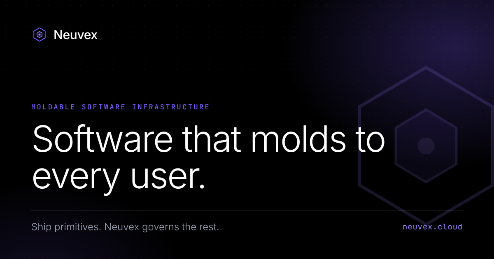

# Neuvex

**Software that molds to every user.**

[Website](https://neuvex.cloud/) · [Email](mailto:operations@neuvex.cloud) · [Founder on LinkedIn](https://www.linkedin.com/in/shriman-maheshwari-195abb32a/)

---

## What Neuvex is

Neuvex is moldable software infrastructure. Vendors expose their app's capabilities as governed, contract-bound **primitives** instead of a fixed UI. Their users' coding agents build custom interfaces and middleware against those primitives inside a sandboxed, auditable, reversible runtime, while the vendor keeps control of data, auth and business logic.

## How it works

1. **Define primitives.** Annotate your existing API and handlers with Neuvex contracts. `neuvex init` scaffolds allow/deny rules on data, actions and scopes.
2. **Users mold.** Any coding agent generates a bespoke interface against your primitives inside the Neuvex sandbox. It touches presentation, never your core.
3. **You stay in control.** Every call, diff and rollback in one console. Revoke or re-scope any primitive at any time.

## Capabilities

- **Contract enforcement:** declarative allow/deny on data, actions and scopes, checked on every call.
- **Sandboxed runtime:** a bad mold breaks a view, never your data.
- **Middleware hooks:** typed, sandboxed, reversible transforms, filters and routing between primitives.
- **Agent-neutral:** works with any coding agent.
- **Data governance:** field-level policies and PII redaction before data reaches an agent.
- **Audit & rollback:** every mold is versioned and diffable.
- **Self-host or cloud:** run Neuvex in your own VPC or on ours.

## Repository contents

This repository is the source of [neuvex.cloud](https://neuvex.cloud/), served by GitHub Pages.

| File | Purpose |
| --- | --- |
| `index.html` | The website: a single self-contained file with inline CSS, JS and structured data |
| `404.html` | Not-found page in the site's design |
| `favicon.svg`, `favicon-32.png` | Browser tab icons |
| `apple-touch-icon.png` | iOS home-screen icon (180 × 180) |
| `icon-192.png`, `icon-512.png` | App icons referenced by the manifest |
| `og-image.png` | Social share image (1200 × 630) |
| `site.webmanifest` | Web app manifest |
| `robots.txt` | Crawler rules and sitemap location |
| `sitemap.xml` | Sitemap for search engines |
| `llms.txt` | Plain-language summary for AI search tools |
| `humans.txt` | Team and site credits |
| `.well-known/security.txt` | Security contact (RFC 9116) |
| `CNAME` | Custom domain for GitHub Pages |
| `.nojekyll` | Tells GitHub Pages to serve files as-is, including `.well-known` |

## Deployment

The site is static and has no build step. Pushing to the default branch publishes it through GitHub Pages, with the custom domain set by `CNAME` and HTTPS enforced in the repository's Pages settings.

`.well-known/security.txt` expires on 13 October 2027. Update the `Expires` line before then.

## Contact

Shriman Maheshwari, Founder & CEO — [operations@neuvex.cloud](mailto:operations@neuvex.cloud)

© 2026 Neuvex. All rights reserved.
